<div align="center">


# Streamline

**A modern video sharing platform: watch, subscribe, post updates and manage your own channel.**


<br />

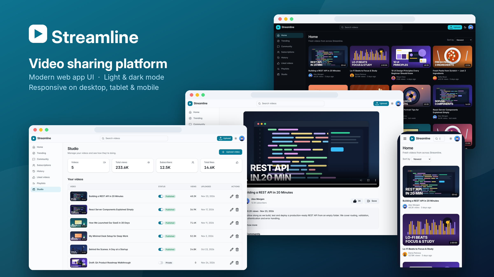

</div>

---

## Table of contents

- [Overview](#overview)
- [Preview](#preview)
- [Features](#features)
- [Tech stack](#tech-stack)
- [Getting started](#getting-started)
- [Environment variables](#environment-variables)
- [Available scripts](#available-scripts)
- [Project structure](#project-structure)
- [Pages and routes](#pages-and-routes)
- [How it works](#how-it-works)
- [Testing](#testing)

## Overview

Streamline is a video sharing platform for watching videos, following channels and managing your own content. This
repository contains the web app (the `frontend/` folder): a responsive single-page application that talks to the
Streamline backend API and ships with light, dark and system themes, skeleton loading states, accessible dialogs and a
full creator Studio.

## Preview

### Sign in

<p align="center">
  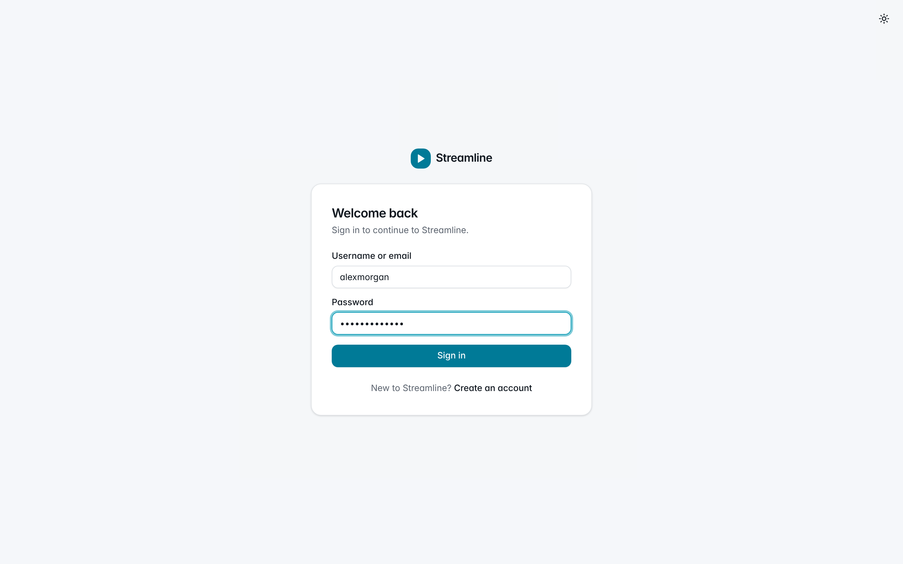
</p>

### Home feed and watching

Browse the latest videos with search, sorting and pagination, then jump into the watch page for the player, likes,
subscriptions, comments and saving to playlists.

<table>
  <tr>
    <td width="50%">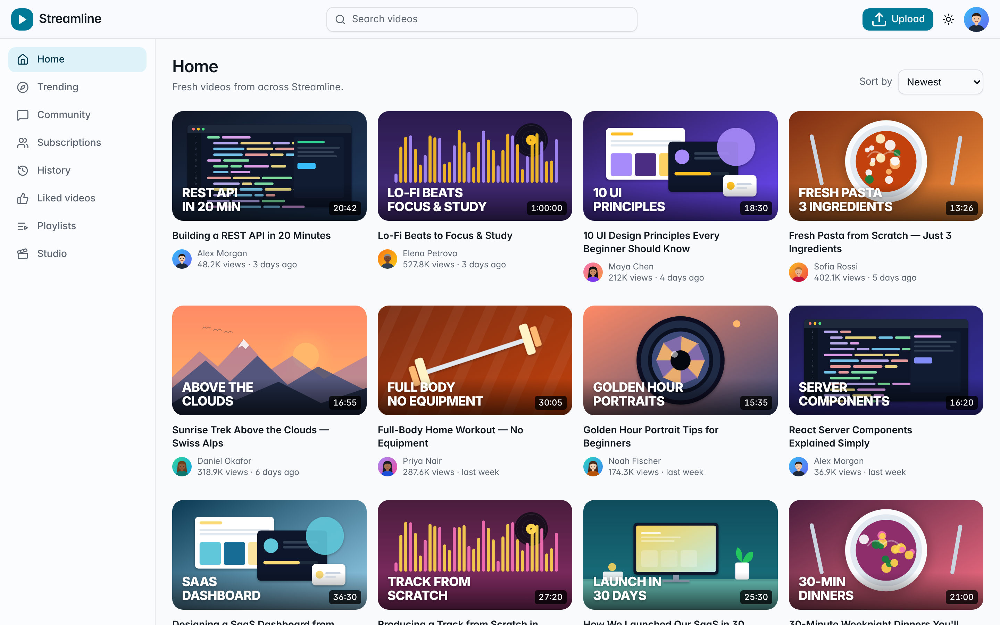<br /><sub><b>Home feed</b></sub></td>
    <td width="50%">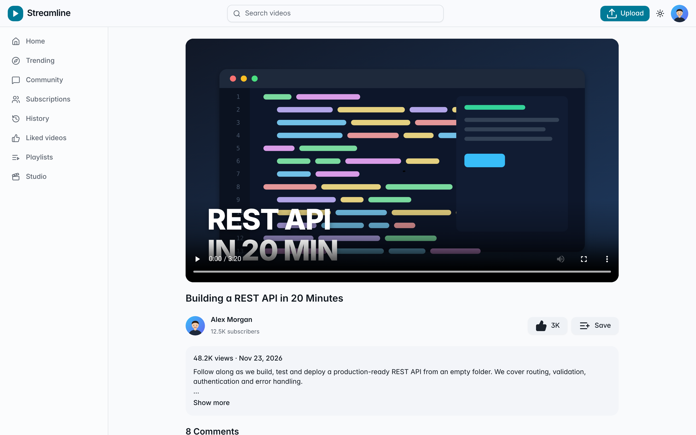<br /><sub><b>Watch page</b></sub></td>
  </tr>
</table>

### Channels and community

<table>
  <tr>
    <td width="50%">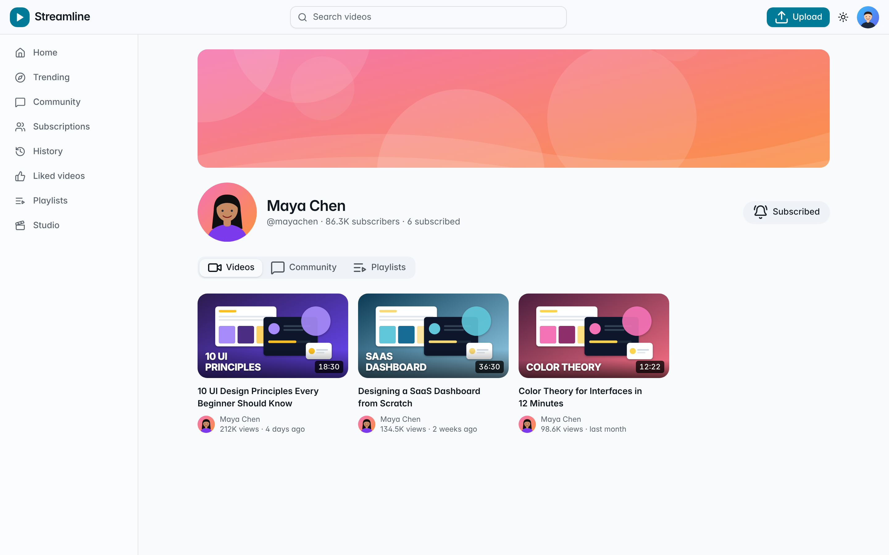<br /><sub><b>Channel</b></sub></td>
    <td width="50%">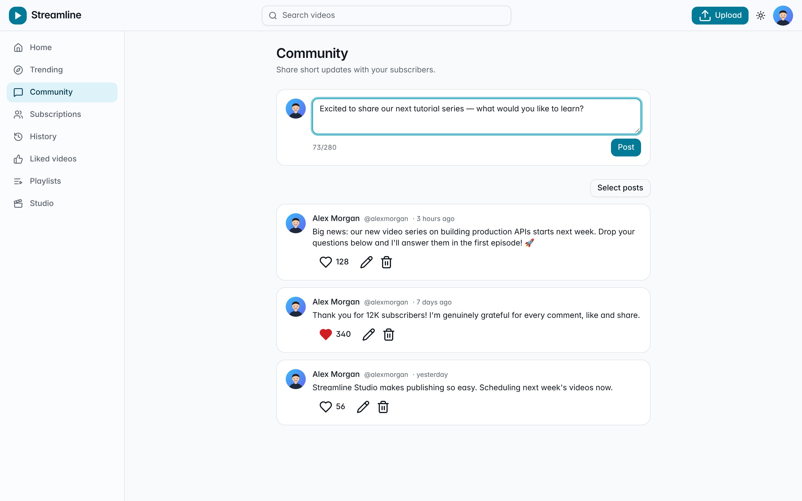<br /><sub><b>Community posts</b></sub></td>
  </tr>
</table>

### Playlists, Studio and settings

Organize videos into playlists, track views, subscribers and likes, upload with progress, edit details, publish or
unpublish, and manage your profile.

<table>
  <tr>
    <td width="50%">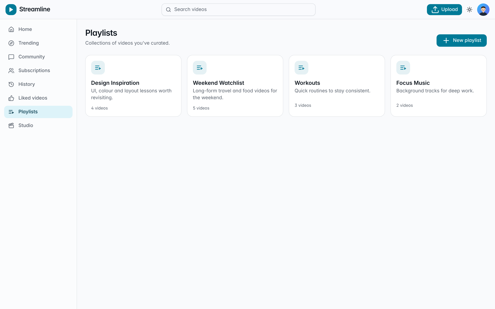<br /><sub><b>Playlists</b></sub></td>
    <td width="50%">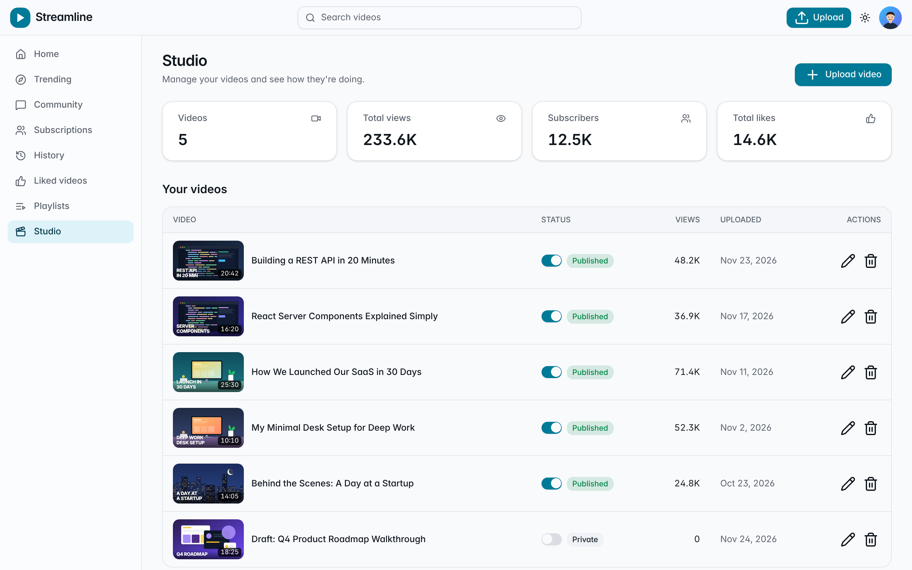<br /><sub><b>Studio dashboard</b></sub></td>
  </tr>
  <tr>
    <td width="50%">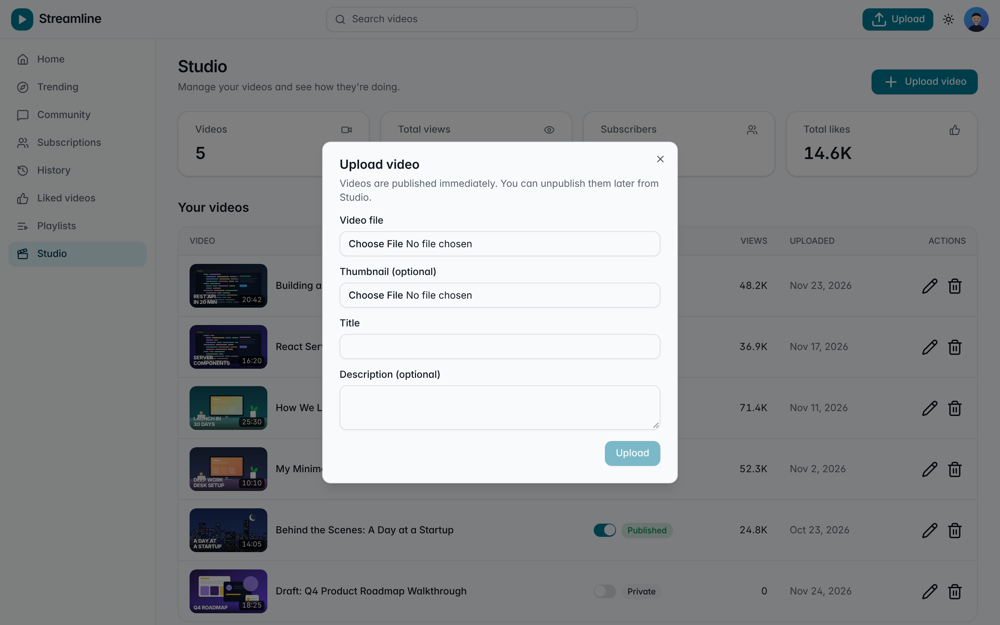<br /><sub><b>Upload video</b></sub></td>
    <td width="50%">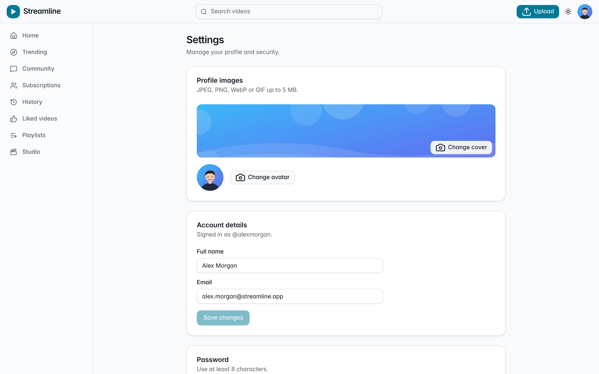<br /><sub><b>Account settings</b></sub></td>
  </tr>
</table>

### Dark mode

<p align="center">
  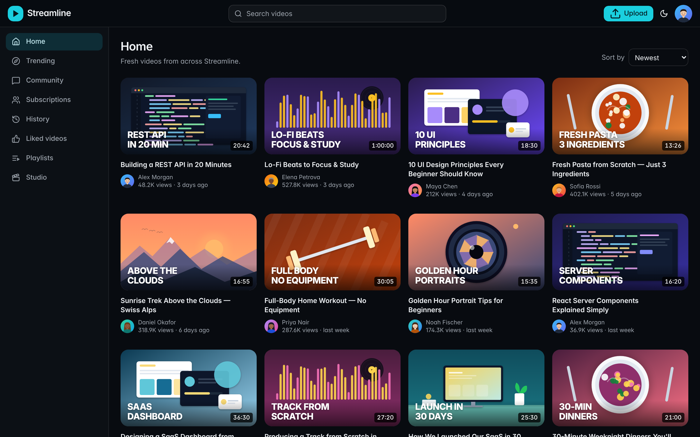
</p>

## Features

- **Complete product:** home feed, trending, search, watch page with likes and comments, channels, community posts,
  playlists, history, liked videos, subscriptions, creator Studio and settings.
- **Modern interface:** responsive layout with a collapsible mobile menu, skeleton loaders, empty and error states,
  confirmation dialogs and toast notifications.
- **Light, dark and system themes:** remembered between visits and applied before first paint, so there is no flash.
- **Safe sessions:** the app never handles tokens (they live in httpOnly cookies), refreshes an expired session once
  even when many requests fail together, and signs the user out cleanly if the refresh fails.
- **Fast:** routes are loaded on demand, and slow responses can never overwrite newer ones.
- **Accessible:** keyboard-friendly dialogs and menus, labelled controls and a skip-to-content link.
- **Forms that match the server:** the same limits as the API (post and comment lengths, password rules, image and
  video sizes) with clear messages when something is rejected.

## Tech stack

| Area          | Technology                                            |
| ------------- | ----------------------------------------------------- |
| Framework     | React 19, TypeScript                                  |
| Build tool    | Vite                                                  |
| Styling       | Tailwind CSS v4, `tw-animate-css`                     |
| UI components | shadcn/ui (Radix UI primitives), Lucide icons, Sonner |
| Routing       | React Router                                          |
| HTTP          | Axios                                                 |
| Quality       | ESLint, Prettier, `tsx` test runner                   |

## Getting started

### Requirements

- Node.js 20 or newer
- The Streamline backend running (default `http://localhost:8000`)

### Installation

```bash
# 1. Go to the frontend folder
cd frontend

# 2. Install dependencies
npm install

# 3. Create your environment file (optional)
cp .env.example .env

# 4. Start the dev server
npm run dev
```

The app is now available at **http://localhost:5173**.

In development, Vite forwards `/api` requests to the backend, so cookies stay same-origin and no CORS setup is needed.

### Production build

```bash
cd frontend
npm run build      # type-check, then build into frontend/dist/
npm run preview    # serve the production build locally
```

## Environment variables

Set these in `frontend/.env` (copy it from `frontend/.env.example`).

| Variable              | Default                 | Purpose                                                     |
| --------------------- | ----------------------- | ----------------------------------------------------------- |
| `VITE_API_URL`        | empty (uses `/api/v1`)  | Full API URL; only needed when the API is on another origin |
| `VITE_DEV_API_TARGET` | `http://localhost:8000` | Where the dev server forwards `/api` (development only)     |

## Available scripts

Run these from the `frontend/` folder.

| Command             | What it does                          |
| ------------------- | ------------------------------------- |
| `npm run dev`       | Start the dev server                  |
| `npm run build`     | Type-check, then build for production |
| `npm run preview`   | Serve the production build locally    |
| `npm run typecheck` | Type-check                            |
| `npm run lint`      | Lint                                  |
| `npm test`          | Unit tests for the helper functions   |

## Project structure

```text
.
├── README.md
└── frontend/
    ├── public/
    │   ├── favicon.svg
    │   └── screenshots/        # Images used in this README
    ├── src/
    │   ├── api/                # Axios client and one module per API area
    │   ├── components/
    │   │   ├── common/         # Cards, pagination, dialogs, loading/empty/error states
    │   │   ├── layout/         # Header, sidebar, app shell, route guards
    │   │   └── ui/             # shadcn/ui building blocks
    │   ├── context/            # Auth and theme providers
    │   ├── hooks/              # useAuth, useTheme, useAsync
    │   ├── lib/                # Formatting, error and file-validation helpers
    │   ├── pages/              # Route pages (watch/ and studio/ hold sub-components)
    │   ├── types/              # Shared TypeScript models
    │   ├── App.tsx             # Routes
    │   └── main.tsx            # Entry point
    ├── tests/                  # Unit tests
    └── vite.config.ts
```

## Pages and routes

| Page                     | Route                                  | What it does                                                  |
| ------------------------ | -------------------------------------- | ------------------------------------------------------------- |
| Sign in / Create account | `/login`, `/register`                  | Authentication; signed-in users are sent home                 |
| Home                     | `/`                                    | Latest videos with search, sorting and pagination             |
| Trending                 | `/explore`                             | Most viewed videos                                            |
| Watch                    | `/watch/:videoId`                      | Player, likes, subscribe, comments, save to playlist          |
| Channel                  | `/c/:username`                         | Videos, community posts and playlists of a creator            |
| Community                | `/tweets`                              | Write and manage your own short posts                         |
| Subscriptions            | `/subscriptions`                       | Channels you follow, with unsubscribe                         |
| History and Liked videos | `/history`, `/liked`                   | Your viewing history and liked videos                         |
| Playlists                | `/playlists`, `/playlists/:playlistId` | Create, edit, delete and fill playlists                       |
| Studio                   | `/studio`                              | Stats, upload with progress, edit, thumbnail, publish, delete |
| Settings                 | `/settings`                            | Avatar, cover image, name, email and password                 |

Signed-out visitors are redirected to the sign-in page and returned to where they were afterwards.

## How it works

- **Sessions:** the user is loaded once when the app starts. If a request returns 401, the app refreshes the session
  once and retries. Parallel requests, even across browser tabs, share a single refresh.
- **Data:** each page loads its own data and keeps it locally. There is no global store for videos or playlists, which
  keeps the code simple and the data fresh.
- **Theme:** light, dark or system, saved in the browser.
- **Components:** the building blocks are standard shadcn/ui components styled with Tailwind design tokens, so colors,
  radius and fonts can be changed in one place. Add more with `npx shadcn@latest add <component>`.

## Testing

`npm test` (run inside `frontend/`) covers the formatting, error-handling and file-validation helpers. Component and
browser tests are not set up yet.