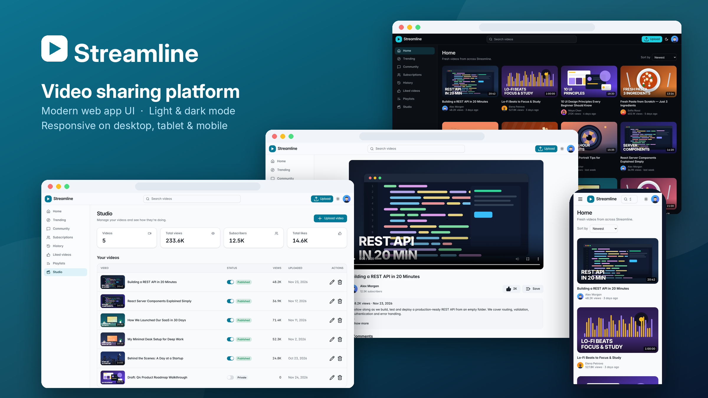

# Streamline frontend

> Part of the Streamline project. See the [main README](../README.md) for the full preview and project overview.

<p align="center">
  
</p>

The web app for Streamline: a responsive single-page application for watching videos, following channels and managing
your own content. It is built with React 19, TypeScript, Vite, Tailwind CSS v4, shadcn/ui and Lucide icons, with light,
dark and system themes.

## Highlights

- **Complete product:** home feed, trending, search, watch page with likes and comments, channels, community posts,
  playlists, history, liked videos, subscriptions, creator Studio and settings
- **Modern interface:** a clean responsive layout with a collapsible mobile menu, skeleton loading states, empty and
  error states, confirmation dialogs and toast notifications
- **Light, dark and system themes:** remembered between visits and applied before first paint, so there is no flash
- **Safe sessions:** the app never handles tokens (they live in httpOnly cookies), refreshes an expired session once
  even when many requests fail together, and signs the user out cleanly if refresh fails
- **Fast:** routes are loaded on demand, and slow responses can never overwrite newer ones
- **Accessible:** keyboard-friendly dialogs and menus, labelled controls, a skip-to-content link
- **Forms that match the server:** the same limits as the API (post and comment lengths, password rules, image and
  video sizes) with clear messages when something is rejected

## Requirements

Node.js 20+ and the Streamline backend running (default `http://localhost:8000`).

## Getting started

Run these from the `frontend/` folder:

```bash
npm install
cp .env.example .env      # optional
npm run dev               # http://localhost:5173
```

In development Vite forwards `/api` requests to the backend, so cookies stay same-origin and no CORS setup is needed.

## Environment variables

| Variable              | Default                 | Purpose                                                     |
| --------------------- | ----------------------- | ----------------------------------------------------------- |
| `VITE_API_URL`        | empty (uses `/api/v1`)  | Full API URL; only needed when the API is on another origin |
| `VITE_DEV_API_TARGET` | `http://localhost:8000` | Where the dev server forwards `/api` (development only)     |

## Commands

| Command             | What it does                          |
| ------------------- | ------------------------------------- |
| `npm run dev`       | Start the dev server                  |
| `npm run build`     | Type-check, then build for production |
| `npm run preview`   | Serve the production build locally    |
| `npm run typecheck` | Type-check                            |
| `npm run lint`      | Lint                                  |
| `npm test`          | Unit tests for the helper functions   |

## Project structure

```text
src/
├── api/          # Axios client and one module per API area
├── components/   # common/ (cards, dialogs, states), layout/ (header, sidebar), ui/ (shadcn/ui)
├── context/      # Auth and theme providers
├── hooks/        # useAuth, useTheme, useAsync
├── lib/          # Formatting, error and file-validation helpers
├── pages/        # Route pages (watch/ and studio/ hold sub-components)
├── types/        # Shared TypeScript models
├── App.tsx       # Routes
└── main.tsx      # Entry point
```

## Pages

| Page                     | Route                                  | What it does                                                  |
| ------------------------ | -------------------------------------- | ------------------------------------------------------------- |
| Sign in / Create account | `/login`, `/register`                  | Authentication; signed-in users are sent home                 |
| Home                     | `/`                                    | Latest videos with search, sorting and pagination             |
| Trending                 | `/explore`                             | Most viewed videos                                            |
| Watch                    | `/watch/:videoId`                      | Player, likes, subscribe, comments, save to playlist          |
| Channel                  | `/c/:username`                         | Videos, community posts and playlists of a creator            |
| Community                | `/tweets`                              | Write and manage your own short posts                         |
| Subscriptions            | `/subscriptions`                       | Channels you follow, with unsubscribe                         |
| History and Liked videos | `/history`, `/liked`                   | Your viewing history and liked videos                         |
| Playlists                | `/playlists`, `/playlists/:playlistId` | Create, edit, delete and fill playlists                       |
| Studio                   | `/studio`                              | Stats, upload with progress, edit, thumbnail, publish, delete |
| Settings                 | `/settings`                            | Avatar, cover image, name, email and password                 |

Signed-out visitors are redirected to the sign-in page and returned to where they were afterwards.

## Upload limits

Images (avatar, cover, thumbnails) can be up to 5 MB and videos up to 100 MB. The app checks the size before uploading
and shows a clear message if a file is too large.

## How it works

- **Sessions:** the user is loaded once when the app starts. If a request returns 401, the app refreshes the session
  once and retries. Parallel requests, even across browser tabs, share a single refresh.
- **Data:** each page loads its own data and keeps it locally. There is no global store for videos or playlists, which
  keeps the code simple and the data fresh.
- **Theme:** light, dark or system, saved in the browser.
- **Components:** the building blocks are standard shadcn/ui components styled with Tailwind design tokens, so colors,
  radius and fonts can be changed in one place. Add more with `npx shadcn@latest add <component>`.

## Testing

`npm test` covers the formatting, error-handling and file-validation helpers. Component and browser tests are not set up
yet.